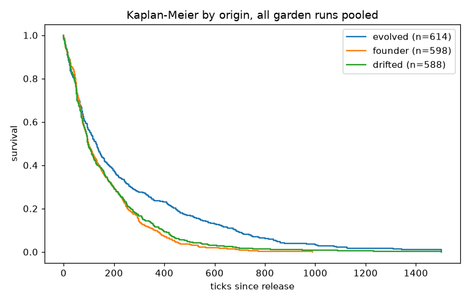
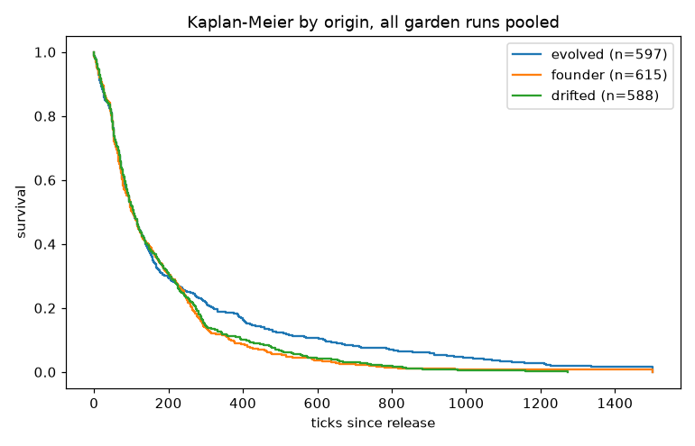
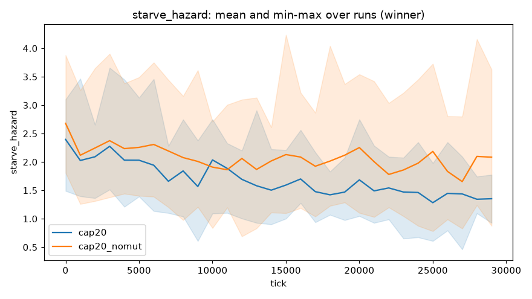
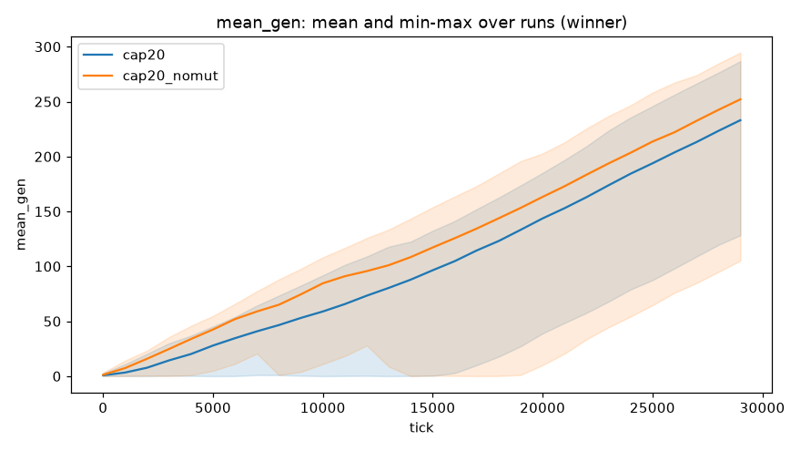

# Evolution in Kingdoms: what we showed and how to rerun it

Status: 2026-11-26, branch `evo/neural`. Evidence for the checklist row "Agents optimizing their behavior…".

## Why the original scene did not evolve

- **Tiny armies and few births.** Start 6, floor 3, cap 15, maturity 150: with a random brain only about 30 % of the soldiers are born (the rest are floor immigrants), and the best lineage reaches generation 3–4 on average (up to 7) in 5000 ticks.
- **Weak coupling.** A soldier's sentence genes move an LLM only a little, so the changes we see in JEV runs are mostly drift (see Limits).
- **Slow.** A JEV run of 5000 ticks takes 6–60 minutes and needs the GPU servers, so we cannot run many seeds.

## What we changed

| | JEV showcase (K02) | Neural proof (K03, K04) |
|---|---|---|
| Brain | JEV (LLM reads the genes) | `NeuralBrain`, the weights are the genome |
| Maturity | 50 on `MatingRule` **and** `AgeSense` | 50 on `MatingRule` only (neural soldiers have no `AgeSense`) |
| Kill chance | 0.25 | 0.25 |
| Start / floor / cap | 6 / 3 / 15 (scene) | 20 / 5 / 20 (`cap20`) |
| Run | 5000 ticks, ~40 min, servers needed | 30 000 ticks, ~25 s, no servers |

**Scene builders** (editor closed, Unity 6000.3.9f1, from the repo root):

- `KingdomsNeuralScene` copies `Kingdoms.unity` to `Assets/Student/Scenes/KingdomsNeural.unity` and makes red and blue neural (menu Tools ▸ Kingdoms ▸ Build Neural Scene; or `-executeMethod KingdomsNeuralScene.RunCommandLine [-source scene] [-out scene]`). Species ids stay `red` / `blue`. The source scene is only copied, never saved.
- `KingdomsGardenScene` turns that scene into `KingdomsGarden.unity`, with a founder pool made of three groups (evolved, founder, drifted); `-executeMethod KingdomsGardenScene.RunCommandLine`.

## Evidence

**Common garden (G4).** We release three groups of 20 networks per army into a fresh world (no floor, cap 60, 3000 ticks, seeds 1–3) and compare their death rates:

- *evolved*: the living soldiers (generation ≥ 1) of the better army of a 30 000-tick source run;
- *founder*: fresh networks from the standard founder pool;
- *drifted*: other founder networks given as many random mutations as the evolved ones carry on their lineages (k ≈ 50 in the first source run we checked), the "mutation alone" control.

Death-rate ratio (95 % CI), pooled over 3 seeds and both armies, for the 10 `cap20` source runs (with mutation) and the 10 `cap20_nomut` source runs:

| | evolved / founder | drifted / founder | source runs with the evolved CI below 1 |
|---|---|---|---|
| Mutating sources, pooled | **0.63 (0.56–0.71)** | 0.94 (0.84–1.05) | **7 of 10** |
| No-mutation sources, pooled | 0.76 (0.68–0.85) | 0.97 (0.87–1.09) † | 4 of 10 |

Per source run (seed of the source run; evolved/founder, drifted/founder):

| source | 1 | 2 | 3 | 4 | 5 | 6 | 7 | 8 | 9 | 10 |
|---|---|---|---|---|---|---|---|---|---|---|
| mutating, evolved | 0.69 | 0.48 | 0.71 | 0.59 | 0.53 | 0.58 | 0.86 | 0.55 | 0.69 | 0.71 |
| mutating, drifted | 1.01 | 0.99 | 1.12 | 1.09 | 0.76 | 0.86 | 0.78 | 0.97 | 0.84 | 1.00 |
| no mutation, evolved | 0.95 | 0.51 | **1.60** | 0.64 | 0.82 | 0.85 | 0.52 | 0.56 | 0.75 | 0.78 |
| no mutation, drifted † | 1.08 | 0.85 | 1.27 | 1.07 | 0.94 | 1.05 | 0.81 | 1.04 | 0.72 | 0.89 |

† In no-mutation sources there are no mutations to copy (k = 0), so this group is a second set of founder networks, not a mutation control.

Evolved soldiers also leave about 2–9 times the offspring of founder soldiers, and 74–91 % of the living soldiers' ancestry at the end is evolved (mutating sources). Kaplan–Meier curves:  

**Trends over 30 000 ticks** (10 seeds, winning army, first → last 1000-tick window; `cap20` / `cap20_nomut`): starvation hazard 2.40 → 1.35 / 2.68 → 2.08 per soldier per 1000 ticks, stop share 0.42 → 0.13 / 0.42 → 0.03, speed 0.47 → 0.66 / 0.47 → 0.72, births per soldier 1.9 → 6.4 / 2.8 → 6.5. The losing army shrinks (8 → 5 soldiers) and stays at a mean generation of about 0.1, kept alive by floor immigrants.  

**What we claim, and what not.** The death rate of soldiers falls because of selection on their networks: evolved networks beat founder networks in 7 of 10 source runs, and the drifted control, which has the same amount of mutation without selection, does not beat them in any. Mutation alone does not help. The no-mutation sources still improve (0.76), so recombination of neurons under selection is enough for part of it; mutation adds the rest (0.63).

## Limits

- **One army wins the shared grass on the 48 m world.** In `cap30` the other army never evolves (0 of 10 runs); in `cap20` both armies evolve in 5 of 10. The losing army lives on floor immigrants. The garden's evolved group always comes from the winner.
- **Drifted k is approximate** (lineage load from `alleles.jsonl`, crossover counted as the mean of the parents). The garden's three cohorts are random draws from the pool (about 10/10/10 per army, not exact); `garden.py` reports the realised sizes.
- **JEV changes are mostly drift.** In the 12 K02 runs the winning allele of a locus is still a founder sentence in 25 of 30 cases in `full` and in all 30 in `nomut`, and a seed does not pin a JEV run (fresh runs with the same seed differ, replays from the answer cache are identical). Neural runs replay exactly: two Unity launches of `cap20` seed 1 give the same events hash.
- Source and garden runs live in `Logs/EvoSim/runs/` (not committed); K04's variants point at those local folders.

## How to rerun (on the 48 m world, or on a new source scene)

Close the Unity editor. From the repo root:

```bash
U=/Applications/Unity/Hub/Editor/6000.3.9f1/Unity.app/Contents/MacOS/Unity
python3 -m pip install -r Tools/Evolution/requirements.txt     # optional: plots; the scripts write CSV and tables without it
```

1. **Neural scene (~30 s).** `$U -batchmode -nographics -projectPath . -executeMethod KingdomsNeuralScene.RunCommandLine -source Assets/EvoSim/Scenes/Kingdoms.unity` (for the 192 m world give its scene as `-source`; it overwrites `KingdomsNeural.unity`). Look for `valid` in the log. Scale start/floor/cap of the `cap20` variant in `K03_KingdomsNeural.asset` to the area.
2. **K03 `cap20`, 10 seeds (~5 min).**
   `for s in 1 2 3 4 5 6 7 8 9 10; do $U -batchmode -nographics -projectPath . -executeMethod KingdomsBatch.RunCommandLine -asset K03_KingdomsNeural -variant cap20 -seed $s -ticks 30000 -logFile /tmp/k03-$s.log; done`
   (variant `cap20_nomut` for the no-mutation sources). Each run is ~25 s and writes `Logs/EvoSim/runs/K03_KingdomsNeural-cap20-s<n>-<time>`; keep one folder per seed.
3. **Trends (seconds).** `python3 Tools/Evolution/neural_trends.py Logs/EvoSim/runs/K03_KingdomsNeural-cap20-s*-* --role winner` (and `--role loser`); plots go to `Logs/EvoSim/plots/`.
4. **Garden scene (~30 s) and K04 (seconds).** `$U ... -executeMethod KingdomsGardenScene.RunCommandLine`, then `python3 Tools/Evolution/make_garden_scenario.py Logs/EvoSim/runs/K03_KingdomsNeural-cap20-s*-*` (writes `K04_KingdomsGarden.asset`, one variant per source run).
5. **Garden runs (a few minutes for 10 sources × 3 seeds).** For each variant name in the asset: `$U ... -executeMethod KingdomsBatch.RunCommandLine -asset K04_KingdomsGarden -variant <name>` (all 3 seeds in one launch, ~5 s per run plus ~30 s start).
6. **Analysis.** `python3 Tools/Evolution/garden.py Logs/EvoSim/runs/K04_KingdomsGarden-*` prints the per-source and pooled table and writes the Kaplan–Meier PNG and a CSV.

JEV showcase (needs the servers, `Tools/EvoSimServers/evosim-connect.sh`): `Tools/Evolution/run_night.sh K02_KingdomsSelection` (12 runs, about 8 hours), then `python3 Tools/Evolution/jev_alleles.py` for the allele plots and the winning-allele table.
